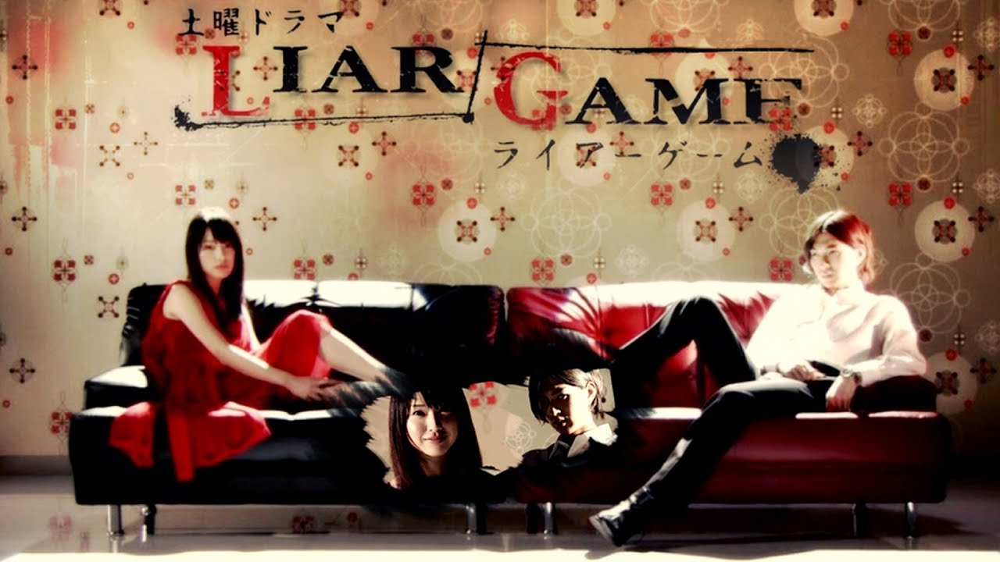
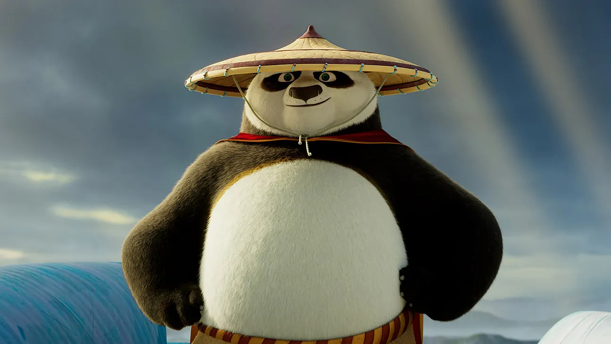
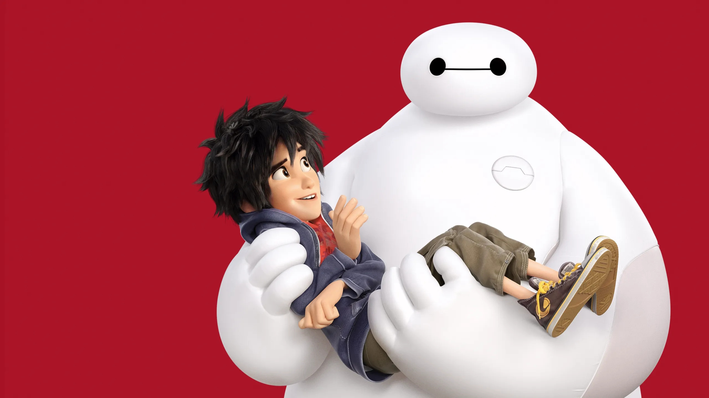

# **My favorite series and movies**

- **Liar Game (2007 TV Series)**
> Is an acclaimed Japanese psychological thriller television drama adapted from Shinobu Kaitani's popular seinen manga. The 11-episode Fuji TV production follows Nao Kanzaki (Erika Toda), a pathologically honest college student who is forced into a high-stakes "Liar Game Tournament" after mysteriously receiving 100 million yen.
Faced with a brutal competition where players must trick, manipulate, and cheat each other to avoid crushing lifetime debt, Nao enlists the help of Shinichi Akiyama (Shota Matsuda), a brilliant master con artist. Together, they form an alliance to outsmart ruthless opponents, exploit complex game theory, and dismantle the shadowy organization orchestrating the game from within.

- **GTO: Great Teacher Onizuka (TV Series)**
> The story follows Eikichi Onizuka, a 22-to-26-year-old former motorcycle gang (bōsōzoku) leader with a vulgar streak and a heart of gold. Rejecting conventional corporate or Yakuza paths, Onizuka decides to become the greatest high school teacher in Japan—initially for the wrong reasons, but he quickly develops a fierce, protective dedication to his students.

- **Kung fu Panda 1, 2, & 3**
> is a masterfully crafted cinematic journey that follows Po, a clumsy noodle-shop-dwelling panda who embraces his unique identity to transform from a bumbling enthusiast into the legendary Dragon Warrior. In the original 2008 film, Po navigates a classic "fish-out-of-water" origin story, learning from Master Shifu that self-acceptance—rather than a mystical secret—is the true key to defeating the ruthless Tai Lung. The darker, critically acclaimed Kung Fu Panda 2 (2011) elevates the emotional stakes as Po confronts the genocidal warlord Lord Shen, learning to achieve inner peace by healing from the trauma of his past and his adoption. Finally, Kung Fu Panda 3 (2016) beautifully rounds out the trilogy's core philosophy of self-discovery by reuniting Po with his biological father and a secret panda village, forcing him to transition from a student into a teacher to master the power of chi and banish the supernatural villain Kai.

- **Big Hero 6**
> Set in the vibrant, high-tech fictional metropolis of San Fransokyo (a stylistic fusion of San Francisco and Tokyo), the story follows Hiro Hamada, a 14-year-old robotics prodigy. After a tragic fire claims the life of his beloved older brother and mentor, Tadashi, Hiro discovers that a masked villain named Yokai has stolen his experimental microbots and is using them for a vengeful plot.
To stop the threat, Hiro teams up with Baymax—a lovable, plus-sized inflatable healthcare robot originally built by Tadashi—and transforms Baymax and four of Tadashi's college friends into a high-tech, crime-fighting superhero team.
